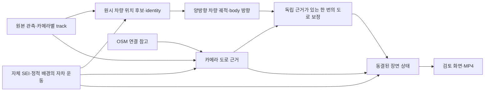

# CT Scene 수정·검증 계획서

작성일: 2026-11-15. **계획 문서이며 아래 구현·재합성 작업은 아직 실행하지 않았다. 작업은 일시중지 상태를 유지한다.**

## 1. 목표와 적용 범위

목표는 원본과 비교해 납득 가능한 다중 카메라 월드 차량 3D 재현이다. 정밀 상용·군용 계측이나 건물 복원을 목표로 확대하지 않는다. 기존 `WORK_PACKAGES.md`의 WP06~WP11과 후속 `EXECUTION_SCOPE_UPDATE.md`를 유지하면서, 중지 시점의 실제 코드와 실패를 기준으로 남은 일을 재정리한다. 기존 계획·실패 보고서는 보존한다.

유지할 사용자 요구:

- 자차 위치·회전은 자체 SEI와 정적 배경에 근거한다. 주변 차량·차로·OSM에 맞춰 자차 궤적을 변경하지 않는다.
- 전방·좌우 리피터를 우선하며 후방은 식별·접근 참고로 사용한다. 현재 4채널 입력을 기준으로 한다.
- 전체 구간의 앞뒤 관측으로 가림·카메라 사이 공백을 보완한다. 모호한 동일 차량을 강제로 연결하지 않는다.
- 정상 주행 차량이 사용한 공간은 차로 후보가 된다. 주차 차량·반대편 차량·횡단 차량을 본선 차로 수의 근거로 사용하지 않는다.
- OSM은 도로 윤곽·연결 참고다. GPS로 자차 차로를 배정하거나 지도 차로 수·폭을 그대로 복사하지 않는다.
- 테슬라 다크, 정후방 1.3배 시점, 주변 차량 클레이, 원본 4채널 하단 strip과 전체 MP4를 유지한다.
- 검수한 영상은 대화 내 재생 가능한 로컬 파일과 Drive `테스트26`을 병행한다.
- 원본·기존 코드·이전 결과를 보존한다. CUDA·빌드·릴리즈·푸시는 하지 않는다.
- 폴·사람 모델은 핵심 차량 재현 검증 이후의 낮은 우선순위다.

## 2. 검토한 기준 상태

근거 문서: `docs/REVIEW_HANDOFF_20261115.md`, `docs/CURRENT_PROGRESS.md`, `../scene-rebuild-plan-20261114/WORK_PACKAGES.md`, `EXECUTION_SCOPE_UPDATE.md`, `VALIDATION_PLAN.md`.

| 항목 | 확인한 상태 | 해석 |
|---|---|---|
| 작업 상태 | 목표 `paused`, suite `stopped_by_user` | 이 계획 작성은 구현 재개가 아님 |
| 최신 엔진 | SHA-256 `444b2a784ec1f50c6940c46bb5f3d2f1ad113b267e17b9a748017fe33e55457b` | 현재 코드와 중지 시 동결 코드가 일치함 |
| 최신 코드 검사 | 중지 전 283개 통과 기록 | 실제 재현 품질의 합격 증거는 아님 |
| 최신 재합성 | 14개 중 12개 발행 완료, 무결성 확인 | 생성 완료 목록이며 전체 검수 합격 목록이 아님 |
| 미완료 재합성 | `branch/aug26`, `branch/oct22` | `*-work` 파일을 완성 영상으로 쓰면 안 됨 |
| 최신 전체 회귀 | `yellow-gauge-fourteen-export-review-001/review.json` 없음 | 아직 전체 판정 없음 |
| 이전 동결본 | 14개 / 16,344프레임 수치 검사 통과 | 그 뒤 원본 대조에서 실제 누락이 발견됐음 |
| 최신 Aug20 수정 | 전체 영상의 선택 50/59초 source 검사 통과 | 마지막 59초 두 차량·2차로의 개발 사건 검사이며 전체 recall이 아님 |
| 기존 라벨 평가 | Audi PASS, Hyundai/Carnival 상대 차로 FAIL | 원래 결과를 보존하며 실패 원인을 나누어 검토해야 함 |
| Drive | 수정 전 검수 영상 13개 | 최신 황색선 수정본 업로드는 아직 없음 |

최신 결과 기준은 `runs/yellow-gauge-full-suite-001/STOPPED_BY_USER.json`이다. 현재 네트워크 조회·추론·재합성·새 테스트는 이 계획 작성에 사용하지 않았다. 소스와 기존 산출물을 읽어 검토했다.

## 3. 코드 검토 결과

아래의 ‘위험’은 정적 코드 검토에서 확인한 경로다. 모든 영상에서 이미 같은 실패가 재현됐다는 뜻은 아니다.

| 우선순위 | 검토 결과 | 코드·증거 | 계획에서의 처리 |
|---|---|---|---|
| P0 | 황색선 좌우를 reference 0 기준으로 보던 오류는 이미 수정돼 있음 | `curved_road.py:supported_boundaries`, Aug20 원본 35~59초 누락, 최신 선택 source PASS | 같은 수정 재작성보다 남은 회귀를 먼저 완료 |
| P0 | 검증 보고서가 FAIL이어도 일부 도구의 프로세스는 정상 종료함 | `tools/evaluate_source_controls.py:main`, `tools/review_completed_exports.py` 마지막 부분 | 종료 코드와 집계 판정을 명확히 연결 |
| P0 | 전체 길이·마지막 5초의 기준이 원본보다 출력의 자체 보고에 의존함 | `quality_review.py:review`의 출력 프레임 비교와 고정 `last_five_seconds_audited=True` | 입력 원본 시계와 대조하고 실제 검사 구간을 기록 |
| P0 | 도로 일부가 미확정일 때 전체 track의 대표 횡좌표와 전역 경계로 제외될 위험이 있음 | `surrounding.py:actor_corridor_lane`, `lane is None` 제외 경로, `road_geometry.py` | 객체 존재·위치 가능 여부·도로 범위 판정을 분리하고 시간별로 판단 |
| P0 | HUD의 `visible_unlocalized`는 최종 입회한 global ID 중심으로 구성됨 | `surrounding.py`의 `membership/presence` 구성 | 제외된 관측까지 포함한 누락 경로를 함께 보여 줌. `scene_audit.py`의 기존 제외 기록을 활용 |
| P0 | 한 합성 함수 안에서 도로 추정·좌표 보정·연결·방향 보정·렌더링이 함께 수행됨 | `surrounding.py`의 lane prior, `compensate_actors`, body/static refinement | 기존 알고리즘을 보존하며 상태 계산과 표시를 단계적으로 분리 |
| P1 | 교차로 후보와 실제 도로 면·차로 연결이 충분히 분리되지 않음 | `junctions.py`, `junction_branches.py`의 opening/고정 길이 표시 가지 | 카메라가 확인한 surface와 연결 힌트·차로 배치를 각각 관리 |
| P1 | camera-only 경로에도 제약이 남아 있음 | `straight_openings`는 지도 없으면 반환, turn 후보도 지도 또는 횡단 근거 필요 | 조용한 교차로·넓은 진입부의 카메라 근거를 별도로 사용 |
| P0 | 검증한 차량·시각만으로는 화면 전체 누락을 판정할 수 없음 | 3대 dense source 평가, 선택 사건 검사, 실제 Aug20 뒤늦은 실패 | 원본 전체 차량 목록과 핵심 사건 라벨부터 보강 |
| P1 | 입력 불지원이 추론 뒤에 발견되는 경우가 있었음 | 최초 Aug20의 SEI 34.8858초 종료 | 무거운 추론 전에 원본/SEI 시간 범위를 검사 |

현재 `association_view`가 `unrefined_position_W`를 사용하는 등 오염을 피하려는 장치는 이미 있다. 실제로 보정된 좌표로 도로를 반복 재추정하는 루프가 존재한다고 단정하지 않는다. 다만 함수 내 상태 변경과 미완료 독립 보정 검증 때문에 그 불변량을 산출물 단위로 증명하기 어렵다.

## 4. 수정 순서와 단계별 종료 조건

### 단계 1 — 검증 판정과 재개 절차부터 정리〔P0〕

대상: `tools/review_completed_exports.py`, `tools/evaluate_source_controls.py`, `tools/review_current_source_witnesses.py`, `tools/recompile_yellow_gauge_suite.py`와 원본 시계 검사.

1. case manifest에 기대 source 목록·전체 길이·현재 산출물 경로·입력/코드/설정/모델 해시를 고정한다. 폴더 이름이나 생성된 결과 개수만으로 완료를 판단하지 않는다.
2. 빈 검사 구간, 누락 source, 일부 사건만 존재하는 preview, 혼합 버전, 미확인 annotation은 합격할 수 없게 한다. `all([])`가 성공하는 검사도 차단한다.
3. `실행 완료`, `파일/수치 합격`, `원본 사건 합격`, `아직 미평가`를 구분한다. FAIL/필수 검사 누락이 있으면 집계가 통과할 수 없게 하고, CLI 종료 코드도 이를 반영한다.
4. 원본 길이/PTS와 출력 길이/상태 시계를 비교한다. 마지막 5초가 실제로 포함됐는지 검사한 시간 구간·프레임 수를 기록한다.
5. 중지된 run은 보존하고 새 재개 run을 만든다. 완료 12개는 엔진·입력·설정·모델 및 artifact 무결성이 같을 때 참조로 재사용하고, 중단된 2개만 새 경로에서 처음부터 생성한다. 깨진 MP4에 이어 붙이지 않는다.
6. 기존 재합성 스크립트는 새 output 전용이다. 현재 경로로 다시 실행하면 재개되지 않으므로 선택 재개 인터페이스를 먼저 추가한다. `stopped_by_user`를 수동으로 `finished`로 바꿔 완료를 만들지 않는다.

평가 도구만 수정할 때는 동결된 기하 엔진을 재작성하지 않는다. 기존 영상은 새 평가기로 읽고, 평가기 버전/해시는 엔진 버전과 별도로 기록한다.

**산출물:** 기대 14개가 들어 있는 case manifest, 누락·빈 구간·FAIL 종료 테스트, 선택 재개 도구, 이전 12개 참조와 새 2개를 묶은 평가 입력 목록.

**종료 조건:** 기존 FAIL 사례가 거부되고, 빈/부분 평가가 거부되며, 14개 전부를 대상으로 평가할 수 있음. 이것은 평가 절차의 통과이며 장면 품질 합격은 다음 단계에서 판정한다.

첫 재개 입력은 다음처럼 고정한다. 아래는 추가할 기능의 명세이며 현재 작동하는 CLI 옵션 목록이 아니다.

| 입력/동작 | 명세 |
|---|---|
| 기준 run | `runs/yellow-gauge-full-suite-001`의 중지 manifest와 기존 `frozen` 엔진 |
| 새 기록 위치 | 예: `runs/correction-baseline-001`; 기존 run은 그대로 보존 |
| 생성 대상 | `branch/aug26`, `branch/oct22` 두 항목 |
| 재사용 대상 | 완료된 12개 artifact를 해시로 확인하고 경로 참조로 등록 |
| case별 필수 기록 | source/track/base/road-mask/OSM/body-heading artifact ID, 엔진·설정·모델 해시, 기존/신규 결과 경로, 기대 시간 범위, reuse/render 이유 |
| 평가 대상 | 생성 대상 2개가 아니라 기대 case 전체 14개. 중복 ID·누락 case·preview 혼입은 거부 |
| 평가 버전 | 새 평가기 해시를 별도 기록. 기존 12개와 다른 기하 엔진으로 만든 2개를 같은 버전으로 묶지 않음 |

두 영상의 재생성에는 기존 `frozen/src`와 동결 설정·GLB를 사용한다. 이후 알고리즘을 수정한 후보와 이 기준 결과는 별개 버전으로 평가한다.

### 단계 2 — 현재 수정본의 기준 결과 확정〔P0〕

알고리즘을 더 바꾸기 전에 황색선 수정의 효과와 부작용을 확정한다.

1. 단계 1의 방식으로 `branch/aug26`, `branch/oct22`를 보충한다. 동일 동결 엔진으로 만들어진 나머지 12개를 재사용한다.
2. 14개 전체 decode/시계/유한값/ID 중복/관측-고스트 충돌/비정상 이동 검사를 수행한다.
3. 원본을 연속해서 보고, 뒤의 검증 표에 있는 핵심 사건과 마지막 5초를 비교한다. 작은 contact sheet만으로 전체 재생 대조를 대체하지 않는다.
4. 새 Aug20의 35~59초 도로 유지, 50/59초 2차로, 59초 두 우측 전방 차량을 확인한다. 기존 실패 영상이 같은 기준에서 실패하는지도 유지한다.
5. 8개 개발 사건 검사와 기존 lane/pocket/ego-change 회귀를 다시 평가한다. 이전 버전 전체 좌표·방향의 동일성을 현재 base 계약과 혼동하지 않는다.
6. Hyundai/Carnival의 기존 FAIL을 유지한 채 원본 라벨을 따로 감사한다. GT 차로가 명확한데 예측이 unknown이면 coverage 실패다. 주차 통로나 교차로에서 차로 번호 자체가 정의되지 않는다면 원본 근거·수정 사유·라벨 버전을 남긴다. 이전 점수와 새 점수는 같은 라벨 버전끼리 비교한다.

**산출물:** 최신 14개 집계, 원본 대조 기록, 기능별 PASS/FAIL/NOT_EVALUATED, 이전 대비 변화표와 가장 나쁜 사건 목록.

**종료 조건:** 현재 알려진 누락의 복구와 기존 통과 사건의 유지가 증명됨. 새 critical 실패가 있으면 해당 원인 단계로 되돌아가며 아래 확장보다 먼저 해결한다.

### 단계 3 — 보이는 차가 도로 판정 때문에 사라지는 경로 수정〔P0〕

대상: `actor_corridor_lane`, `road_geometry`, `scene_audit`, 관측→world→화면 집계.

1. 객체의 `관측 존재`, `ID 연결`, `3D 위치`, `차로`, `표시 범위`를 별도로 관리한다. 차로 unknown을 객체 없음으로 바꾸지 않는다.
2. whole-track 대표 lane 하나로 전체 시각을 제외하지 않는다. 지지된 도로 구간·교차로·미확정 구간별로 판정하고, 같은 차량의 ID는 유지한다.
3. 카메라 중앙선/분리대 근거가 분명한 반대편 차량은 표시에서 제외한다. 근거가 불명확한 경우 단순 전역 경계 밖이라는 이유만으로 삭제하지 않는다. 횡단·합류로 진입하는 차량은 별도 상태로 유지한다.
4. 지면 접점이 실패해도 detector/flow 원본 관측과 ID를 보존한다. 선명한 앞뒤 관측으로 복원이 가능하면 추정 위치를 사용하고, 불가능하면 `위치 미확정`으로 남긴다. 차로 중앙에 강제로 놓지 않는다.
5. 관측 중이고 위치가 복원된 차량은 clay, 실제 시야 공백의 복원은 ghost로 구분한다. ghost만 늘려 차량 표시율을 높이지 않는다.
6. 누락 집계를 `검출 못함 → 추적 조각 → 연결 미확정 → 위치 미확정 → 범위 제외 → world에 있으나 화면 밖/가려짐 → 표시`로 나눈다. 기존 제외 감사 기록을 재사용한다. 원본 GT와 대조하기 전에는 이 집계를 recall이라 부르지 않는다.
7. 1.3배 확대 시점의 frustum도 검사한다. world state에 존재하는 것과 실제 화면에 그려진 것은 별도 결과로 기록한다.

**검증:** 새 Aug20, 우측 리피터 접근, 잘린 측방 차량, 반대편 차량 제외, 실제 횡단 차량 유지, 빈 도로 음성 사례.

**종료 조건:** 핵심 차량의 모든 미표시 구간에 원인이 있으며, 잘못된 도로 판정만으로 관측·ID·3D가 소거되는 사건이 없음. 불확실한 모든 검출을 3D 차량으로 그려 false positive를 늘리는 해결은 허용하지 않는다.

### 단계 4 — 후보정과 표시를 분리하고 운동·방향을 안정화〔P0〕

전체 재개발 대신 기존 함수를 단계적으로 분리한다. 먼저 구조만 옮겨 같은 입력의 world 결과가 유지되는지 확인하고, 그다음 동작을 수정한다.

목표 데이터 흐름:

차량이 사용한 corridor로 도로 범위를 보완할 때는 **보정 전 좌표**를 사용하고 의존 차량 ID를 남긴다. 보정 후 궤적으로 같은 도로를 다시 만들어 정답처럼 사용하지 않는다.

구체 작업:

- 현재 `actors.json`, road, render state 형식을 활용해 ‘표시 직전 장면 상태’를 먼저 발행한다. renderer는 이 상태를 읽고 world 좌표·ID·방향을 변경하지 않는다. 시점 변경은 view에만 적용한다.
- `lane_prior`, body 방향, 정차 mesh fitting, 자차 변경 구간의 보정을 명시적인 trajectory revision으로 옮긴다. 부모 artifact·입력 관측·적용 시간·전후 좌표·이유를 기록한다.
- 도로 근거가 대상 차량 자신에게 의존하면, 해당 차량을 제외한 근거로도 보정 가능한지 검사한다. 독립 근거가 없으면 강한 중앙 정렬 보정을 적용하지 않는다. 차량 corridor는 도로 존재의 추정으로 남긴다.
- 기존 `unrefined_position_W` 기반 연결과 동결 선행차 계약을 보존한다. 관측·raw 위치·보정 위치를 같은 필드에 덮어쓰지 않는다.
- 동결 계약은 같은 base를 소비하는 후속 단계의 계약이다. 원본에서 base 자체가 잘못됐음이 확인되면 입력 근거와 이유를 남긴 새 base revision을 발행하고, 구버전 보존과 별도 재검증을 수행한다. 잘못된 base를 영구 정답으로 고정하거나 renderer에서 몰래 수정하지 않는다.
- 가림 복원은 양쪽 끝의 ID·진행 차로·방향이 일치할 때 우선 적용한다. 끝 차로가 다르면 실제 변경 후보를 검토한다. 불분명한 연결은 후보로 남기고 무제한 외삽하지 않는다.
- 정차 시 접점 jitter의 속도로 차량 앞뒤를 뒤집지 않는다. 기존 base 발행 전 방향 연속성 수정은 유지한다. 실제 회전/후진/차선 변경을 평활화로 없애지 않는 paired case를 둔다.
- 자차 변경 구간의 보정은 해당 window에 한정한다. 원본에서 실제로 다른 차가 변경한 positive 사례를 반드시 추가해, 주변 차량 전부를 고정하는 편법을 막는다.
- projection/front↔repeater 접합 편향이 원본에서 반복될 때만 필요한 카메라 파라미터를 제한적으로 재검토한다. 다른 날짜·다른 차량에도 같은 설정을 검증하고 source ID별 offset을 넣지 않는다.
- 기하 보정의 fitting/검증 프레임을 분리한다. 차량 크기·yaw·depth를 동시에 자유롭게 바꿔 bbox만 맞추지 않으며, 가시 부분의 원본 재투영과 앞뒤/좌우 관계를 함께 확인한다. fitting에 쓴 bbox의 잔차만으로 독립 정확도 합격을 주장하지 않는다.

**산출물:** 동결 장면 상태, 궤적 revision/도로 의존성 기록, leave-one-track-out 결과, 변경 전후 world/ego-relative 경로, 카메라 전환 재투영 비교.

**종료 조건:** 렌더 시점·OSM·도로 prior 변경이 자차 궤적을 바꾸지 않음. raw 관측과 동결 anchor가 보존됨. 자차 변경 음성 사례와 실제 타 차량 변경 양성 사례를 함께 통과함.

### 단계 5 — 곡선·교차로·합류·넓은 도로 표시 개선〔P1〕

대상: `road_sections`, `road_geometry`, `junctions`, `junction_branches`, 도로 mask/paint 누적.

1. `도로 면이 보임`, `차로 배치가 알려짐`, `도로 연결이 알려짐`을 구분한다. 표식 공백만으로 도로 면 전체가 사라지게 하지 않는다.
2. 곡선의 국소 station/lateral 좌표를 유지하고, 황색선 좌우는 같은 station의 고정 자차 위치와 비교한다. 기준선 이동·world 회전/평행 이동에 대해 판정이 보존되는 검사를 추가한다.
3. 교차로 진입·내부·이탈을 구분한다. 내부에 평행 차선을 무리하게 연장하지 않고, 관측된 진입/이탈 차로 연결을 이용한다. discrete 차로를 확정 못 해도 차량의 world 운동과 앞뒤/좌우 관계는 유지한다.
4. camera-only 후보는 반복되는 도로 면의 열림, 경계의 분기, 횡표식, 횡단 교통, 자체 회전 등 복수 근거로 만든다. 표식 소실 하나나 회전 하나만으로 일반 곡선을 교차로로 바꾸지 않는다.
5. OSM은 넓은 위치 허용 범위에서 연결 후보를 제공한다. 실제 opening 위치·차로·폭은 영상으로 결정한다. 다층 도로는 같은 레벨 근거가 없으면 연결하지 않는다.
6. 현재 고정 길이 가지 표시는 ‘연결 힌트’로 유지하고 실제 asphalt 면과 구별한다. 카메라가 보지 못한 가지 전체를 관측된 도로처럼 채우지 않는다.
7. 합류·분기는 도로 graph 연결/차로 수 전환으로 처리한다. section의 lane 번호가 달라졌다는 사실만으로 차량 차로 변경을 만들지 않는다. 실제 합류 차량이 있는 원본 사례를 별도로 검사한다.
8. 톨게이트 광장은 확인된 drivable surface를 먼저 그린다. 보이지 않는 평행 차선 수나 시설물을 임의로 추가하지 않는다.
9. 정상 주행 corridor, 주차 공간, 반대편, 횡단 공간을 나눠 도로 후보를 만든다. 한 접근 차량의 위치가 불확실하다는 이유로 그 차를 지우거나 영구 본선 차로를 늘리지 않는다.

**음성 검사:** OSM 없음, GPS 평행 이동, 지도 lane/width 태그 변경, 위아래로 교차하는 도로, 빈 교차로, 일반 곡선. 지도 조건이 달라도 자차 pose와 영상 관측은 같아야 한다.

**종료 조건:** 실제 좌/우회전·직진 교차로·합류에서 도로 연결과 차량 운동을 각각 원본으로 확인함. 광장이나 도로가 그럴듯해 보이는 것으로 차량 추적 실패를 통과시키지 않음.

### 단계 6 — 다양성 평가·실험실·영상 전달 마무리〔P0 최종 게이트〕

1. 아래 데이터 목록을 기준으로 전체 재생·사건별 채점·마지막 5초를 검사한다. 수동 교정본은 자동 결과와 분리한다.
2. 코드·모델·광학·설정·입력·annotation·게이트·평가기 버전을 동결한다. 결과를 보고 바꾼 기준은 별도 버전으로 남기고 동일 기준으로 이전 결과도 다시 평가한다.
3. 편집기 메뉴에서 선택한 source/scene과 CLI가 같은 상태·MP4를 사용하는지 확인한다. 취소·재개·잘못된 파일·버전 불일치·DirectML/CPU 선택도 검사한다.
4. 전 구간 SEI/카메라 시간 범위를 추론 전에 점검한다. 지원하지 않는 구간은 원인을 알려 주고, 임의 정지 처리나 조용한 구간 절단으로 전체 영상 성공을 만들지 않는다.
5. 동일한 export 경로로 30초 이상 저속·주간 80km/h 이상·교차로 전체 영상을 제공한다. 다크/정후방 1.3배/클레이/하단 4채널을 유지한다.
6. 원본 strip의 실제 source hash/PTS/프레임 선택을 검사한다. 검출 5Hz와 출력 20fps를 구별하며 반복 프레임을 새 관측으로 세지 않는다. 원본 대조는 원래 MP4의 실제 프레임으로 수행한다.
7. 로컬 재생 링크와 Drive `테스트26` 링크, 검수 상태가 들어간 최신 index를 함께 제공한다. 이전/실패/미검수 영상을 완료본과 혼동하지 않게 한다.
8. 기존 업로드와 로컬 영상 바이트가 같으면 링크를 재사용한다. 새 영상만 올리고 부모 폴더·크기를 다시 대조한다. 코드·영상 버전이 다른 것을 같은 검수본으로 표시하지 않는다.

**종료 조건:** 실행·재생·내보내기뿐 아니라 약속한 핵심 원본 사건까지 통과하고, 남은 실패/미평가 범위를 전달함. 필수 사건 실패나 검증 누락이 있으면 전체 완료로 표시하지 않는다.

### 단계 7 — 폴·사람 모델〔P2, 핵심 게이트 이후〕

기존 GLB의 방향·원점·크기를 재사용한다. 사람/폴 관측과 지면 위치 근거가 충분할 때만 배치하며, 자동차와 다른 접지·크기·방향 정책을 쓴다. 이 작업으로 차량 추적·도로 범위·최종 검증을 미루지 않는다. 6채널 실영상이나 해당 모델 관측이 없으면 미평가로 남긴다.

## 5. 검증 데이터와 원본 라벨 계획

### 5.1 현재 14개 개발 구간

모두 이미 출력 또는 원본을 검토한 개발 자료다. 향후 수정에 사용하더라도 독립 holdout으로 다시 부르지 않는다.

폴더 분류 `six`는 추가 영상 6개 묶음이라는 뜻이며, 6채널 처리라는 뜻이 아니다.

| 구분 | source | 우선 확인할 원본 사건 |
|---|---|---|
| four | 2026-08-16_14-59-58 | 저속·주차·회전, 후반 Carnival 존재/방향, 차로 의미 감사 |
| four | 2026-08-25_08-20-56 | 자차 회전, 정차 K5 front→right 연결과 가림, 정차 body 유지 |
| four | 2026-09-02_12-07-46 | 빈 2차로, 허위 차량·차로 생성 없음 |
| four | 2026-09-07_18-09-51 | 다차로 정체, 중앙선 안쪽 좌측 SUV, 우측 Hyundai, 교차로 이후 도로 전환 |
| branch | 2026-10-26_12-01-20 | 짧은 횡단 트럭·body 방향, 7/11초 부근 방향 회귀 |
| branch | 2026-08-28_08-55-51 | 포켓, 자차 변경 완료 26.99초 부근, 반대편 제외와 실제 연결 보존 |
| branch | 2026-08-26_08-32-43 | 선행 버스, 본선/우측 도로 범위, rear body 방향 |
| branch | 2026-10-22_08-11-29 | 자차 회전, 횡단 차·버스 유지, 반대편 제외, 26초 방향 회귀 |
| six | 2026-08-26_08-33-44 | 버스 옆 진입·회전 전 다차로 접근부·이후 본선 |
| six | 2026-09-14_22-14-31 | 야간 빈 도로·곡선·반대편 전조등 false positive |
| six | 2026-10-02_14-58-03 | 주간 SEI 최고 약 92km/h, 자차 변경·접근·우측 차량 |
| six | 2026-10-18_11-23-27 | 빈 곡선 램프·톨게이트 광장·출구 연결 |
| six | 2026-11-10_22-07-20 | 야간 SEI 최고 약 102km/h, 곡선·경계·정차 차량 |
| six | 2026-08-20_07-34-02 | 진입 후 2차로, 35~59초 누락 회귀, 우측 전방 차량 |

이 외에 기존 October 21 / September 17 자차 변경과 October 2 터널 회귀를 기존 manifest에서 source hash로 찾아 포함한다. 같은 파일·같은 recording event의 중복은 별개 독립 표본으로 세지 않는다.

**반드시 보충할 양성 사건:** 실제 타 차량의 차선 변경, 차량이 실제로 진입하는 합류. 자차 변경이나 빈 램프만으로 이 두 항목을 통과시키지 않는다. 기존 원본에서 먼저 찾고, 없으면 미평가 사유를 기록한다.

### 5.2 라벨 작성 범위

- 원본 pass에서 예측을 숨기고 중요 차량 목록·앞뒤/좌우·same/opposite/crossing·도로 끝·변경/가림 사건을 기록한다. 검출된 차만 정답으로 등록하지 않는다.
- 먼저 한 pilot의 전체 30~60초를 완결한다. 핵심 차량은 5Hz, 전환/가림/변경/회전 경계 ±1초는 가능한 실제 프레임에서 10Hz 이상으로 확인한다. 자동 전파는 원본 확인 전까지 미검토 상태다.
- 나머지 개발 영상은 전체 연속 재생과 일정 간격의 원본 차량 목록으로 누락을 훑고, 문제/핵심 사건을 같은 밀도로 확장한다. 대부분이 라벨되지 않은 상황을 전체 recall로 보고하지 않는다.
- GT unknown과 예측 unknown을 별도 기록한다. 명확한 GT를 모델이 못 판단한 것은 coverage 손실이다. GT가 불명확한 부분은 점수에서 빠진 분모와 사유를 공개한다.
- 이미 예측을 본 source는 라벨 화면을 숨겨도 개발 자료다. 노출 이력을 `prediction_viewed=false`로 되돌리지 않는다.
- 새 날짜 검증은 inventory·full hash·recording event·SEI 범위를 먼저 고정한다. 유효한 미사용 날짜가 부족하면 `NOT_EVALUATED`로 남기며, 같은 날짜의 다른 clip을 독립 날짜 검증으로 대체하지 않는다.
- 독립 날짜 자료가 부족한 상태의 검토본 전달은 가능하다. 이 상태를 독립 날짜 평가 달성이나 WP10 전체 완료로 기록하지 않는다.

## 6. 원본 기준 합격 조건

아래 수치는 구현 전에 source 라벨 신뢰도와 함께 동결할 **내부 제안값**이다. 사용자와 합의된 상용 성능 보증이 아니다. 기존 FAIL을 지우기 위한 사후 완화는 하지 않는다.

| 구분 | 제안 게이트 | 증거 |
|---|---|---|
| 전체 시간 | 기대 source 전부 존재, 원본 시간 범위·전체 길이·출력 시계 일치, 실제 마지막 5초 포함 | 원본 PTS/SEI, full decode, 검사한 시간 범위 |
| critical 사건 | ID swap/잘못된 병합·복제/순간이동/무근거 180도 flip/횡단·합류 차량 오제외 0건 | 독립 원본 사건 라벨과 해당 전후 영상 |
| 보이는 핵심 차량 | 원본에서 계속 보이는데 0.5초 초과 무설명 소멸 0건을 초기 목표로 함 | detector miss까지 포함한 GT track·object-second 분모 |
| 관계 | 명확한 GT의 앞뒤·좌우·진행 방향·차로 오판 사건 0건, 알려진 관계 제공률 95%를 초기 목표로 함 | 조건부 정확도와 coverage를 함께 보고 |
| 차선 변경 | 자차/타 차량 방향 일치, crossing/completion이 GT 불확실 구간에서 ±0.5초 이내를 초기 목표로 함 | 시작·통과·완료·완료 후 유지의 원본 구간 |
| 가림 | 같은 차의 앞뒤 관측 연결, source 없을 때만 ghost, 복제·반대 차로 복원 없음 | 전환 원본 crop/ID/관계와 gap 지원 기록 |
| 도로 | 명확한 구간의 차로 수·중앙선·도로 끝 일치, 명확한 도로의 근거 없는 소멸 0건 | raw road 라벨·2D 재투영·topology 사건 |
| 자차 불변 | 도로/OSM/주변차 prior on/off에서 자차 pose가 같은 artifact/hash | 고정 ego 입력 비교. 미터 정확도 주장에는 쓰지 않음 |
| 표시 분리 | view 변경으로 world 좌표·ID·yaw 불변 | 같은 장면 상태의 다른 view 비교 |
| 최종 전달 | 저속/주간 80km/h 이상/교차로 전체 영상, 로컬+Drive, 같은 버전/파일 | MP4 hash·길이·Drive 부모/크기·최신 index |

차로가 원본에서 명확한데 unknown이 많은 경우는 합격시키지 않는다. 교차로 내부의 lane index가 불명확해도 관측 차량의 존재와 world 운동·좌우 관계 검사를 생략하지 않는다. 작은 내부 분산을 실제 cm 정확도로 보고하지 않는다.

## 7. 반복 비용과 변경 통제

| 바뀐 것 | 재사용할 것 | 다시 계산/검토할 것 |
|---|---|---|
| 평가 코드 | 기존 전체 영상·관측·추론 | 새 평가 보고서·원본 대조. 평가기 해시 별도 기록 |
| 도로 의미/범위·후보정 | 원본·raw 검출/track·변경 없는 자차/base | 영향받는 도로·차량 revision·연결·장면·영상 |
| 렌더 색·시점만 | 동결 world state와 모든 추론 | 렌더·frustum·영상/strip. world 불변 검사 |
| 모델/전처리 | 변경 없는 원본·다른 단계 | 해당 관측과 의존 단계 |
| 광학/장착 파라미터 | raw space 전처리가 같다면 raw detector 결과 | 해당 projection·회전/방향 근거·geometry와 의존 단계 |
| source/시간 기준 | 바뀌지 않은 독립 원본 | 영향을 받는 sampling·연결·기하·출력 및 cache 적합성 |

매 수정은 `원인 가설 → 의미 있는 단위 검사 → 대상 사건 preview → 대상 전체 영상+짝 음성 사례 → 영향 회귀 → 최종 전체 묶음` 순서로 진행한다. 대상 사건이 계속 실패하는 동안 14개 전체를 반복 생성하지 않는다. 모델을 더 무겁게 하는 작업은 누락 원인이 실제 검출 단계라는 증거가 있을 때만 검토한다.

첫 재개 묶음은 **단계 1과 단계 2**로 제한한다. 결과로 남은 critical 실패를 확정한 뒤 단계 3~5의 변경을 한 종류씩 적용한다. 처리 시간·재사용/새 계산 수·원본 검토 시간을 따로 기록하고, 총 합격 판정을 테스트 개수로 대체하지 않는다.

## 8. 최종 제출물과 완료 판정

- `source-review` 기록: GT 목록·라벨 버전·분모·핵심 사건별 결과·worst 사건.
- 고정된 ego/관측, road 근거, raw/보정 trajectory, 동결 장면 상태와 각 부모 hash.
- 전체 source/candidate 목록, 실행 실패·불지원 입력·미평가 기능을 포함한 검증 집계.
- UI/CLI/MP4 동일성·취소/재개·입력 오류 검증 기록.
- 로컬에서 바로 재생할 전체 MP4와 Drive `테스트26` 최신 index.
- 기존 결과 대비 고친 것·악화된 것·남은 한계 및 WP06~WP11 최종 판정표.

필수 원본 사건이 실패하거나 분모가 빠져 있으면 미완료다. 독립 날짜·실측 거리·4GB 장치·6채널 등 실제로 검증하지 못한 범위는 명시한다. 폴·사람 모델 추가 여부로 핵심 차량 재현의 완료를 대신하지 않는다.

**현재 상태:** 소스와 기존 기록 검토 및 이 계획 작성만 수행했다. 구현·추론·재합성·업로드를 재개하지 않았고, 목표는 일시중지 상태를 유지한다.
